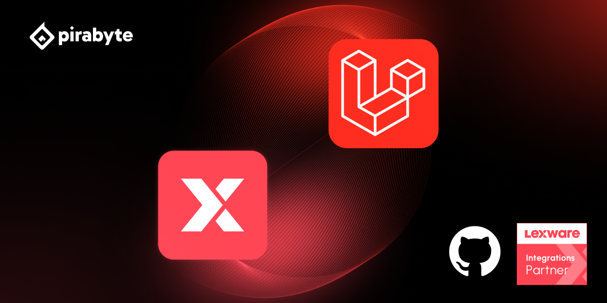

# Laravel Lexware Office

[](https://github.com/pirabyte/laravel-lexware-office/actions/workflows/tests.yml)
[](https://codecov.io/github/pirabyte/laravel-lexware-office)

Laravel-Client für die Lexware Office API mit typisierten Modellen, OAuth2-Unterstützung und lokalem Rate-Limit. Unterstützt PHP ab 8.3 sowie Laravel 11 bis 13.

## Installation

```bash
composer require pirabyte/laravel-lexware-office
```

Trage deinen API-Key in `.env` ein:

```dotenv
LEXWARE_OFFICE_API_KEY=dein-api-key
```

Laravel lädt die Paketkonfiguration automatisch. Wenn du sie anpassen möchtest, veröffentliche sie mit:

```bash
php artisan vendor:publish --provider="Pirabyte\LaravelLexwareOffice\LexwareOfficeServiceProvider" --tag="lexware-office-config"
```

Für die Speicherung von OAuth2-Tokens in der Datenbank kannst du zusätzlich die Migration mit `--tag="lexware-office-migration"` veröffentlichen. `--tag="lexware-office"` veröffentlicht Konfiguration und Migration zusammen.

## Verwendung

Mit dem konfigurierten API-Key nutzt du die Facade:

```php
use Pirabyte\LaravelLexwareOffice\Facades\LexwareOffice;

$contact = LexwareOffice::contacts()->get($contactId);
```

Für einen anderen API-Key erstellst du einen eigenen Client:

```php
use Pirabyte\LaravelLexwareOffice\LexwareOfficeFactory;

$client = LexwareOfficeFactory::withApiKey($apiKey);
$contact = $client->contacts()->get($contactId);
```

Weitere Beispiele: [Kontakte](examples/contacts.md), [OAuth2](examples/oauth2-authentication.md), [Fehlerbehandlung](examples/error-handling.md) und [Partner-Integrationen](examples/partner-integrations.md).

## Implementierungsstand

Diese Ressourcen und Methoden sind derzeit im Paket implementiert:

| Bereich | Zugriff | Methoden |
| --- | --- | --- |
| Kontakte | `contacts()` | `create`, `get`, `update`, `filter`, `all`, `count`, `getAutoPagingIterator` |
| Belege | `vouchers()` | `create`, `createAndAttachFile`, `get`, `update`, `filter`, `all`, `document`, `downloadDocument`, `attachFile` |
| Rechnungen | `invoices()` | `create`, `get`, `file`, `electronicDocument` |
| Rechnungskorrekturen | `creditNotes()` | `create`, `get`, `file`, `electronicDocument` |
| Drucklayouts | `printLayouts()` | `all` |
| Zahlungsinformationen | `payments()` | `get` |
| Event-Abonnements | `eventSubscriptions()` | `create`, `all`, `get`, `delete` |
| Dateien | `files()` | `download` |
| Länder | `countries()` | `all` |
| Finanzkonten | `financialAccounts()` | `create`, `get`, `filter`, `delete` |
| Finanztransaktionen | `financialTransactions()` | `create`, `get`, `update`, `delete`, `latest`, `getVoucherAssignments` |
| Buchungskategorien | `postingCategories()` | `get` |
| Profil | `profile()` | `get` |
| Transaktionszuweisungshinweise | `transactionAssignmentHints()` | `create` |
| Partner-Integrationen | `partnerIntegrations()` | `get`, `update` |

### Besonderheit bei der neuesten Finanztransaktion

`financialTransactions()->latest($financialAccountId)` kann bei einem bestehenden Finanzkonto ohne Transaktionen eine 404-Antwort von Lexware erhalten. Die Methode gibt nur bei einer erfolgreichen, leeren Antwort `null` zurück. Wenn du prüfen musst, ob das Konto existiert, nutze zusätzlich `financialAccounts()->get($financialAccountId)`.

## Rechnungen und Rechnungskorrekturen (vorbereitet für 0.5.0)

```php
use Pirabyte\LaravelLexwareOffice\Enums\FileFormat;
use Pirabyte\LaravelLexwareOffice\Enums\LineItemType;
use Pirabyte\LaravelLexwareOffice\Enums\ShippingType;
use Pirabyte\LaravelLexwareOffice\Enums\TaxType;
use Pirabyte\LaravelLexwareOffice\Models\LineItem;
use Pirabyte\LaravelLexwareOffice\Models\SalesVoucherAddress;
use Pirabyte\LaravelLexwareOffice\Models\ShippingConditions;
use Pirabyte\LaravelLexwareOffice\Models\TaxConditions;
use Pirabyte\LaravelLexwareOffice\Models\TotalPrice;
use Pirabyte\LaravelLexwareOffice\Models\UnitPrice;
use Pirabyte\LaravelLexwareOffice\Requests\InvoiceCreateRequest;

$request = new InvoiceCreateRequest(
    voucherDate: '2026-11-01T00:00:00.000+01:00',
    address: new SalesVoucherAddress(contactId: $contactId),
    lineItems: [new LineItem(
        type: LineItemType::CUSTOM,
        name: 'Beratung',
        quantity: 1,
        unitName: 'Stunde',
        unitPrice: new UnitPrice(taxRatePercentage: 19, netAmount: 100),
    )],
    totalPrice: new TotalPrice(),
    taxConditions: new TaxConditions(TaxType::NET),
    shippingConditions: new ShippingConditions(ShippingType::SERVICE, shippingDate: '2026-11-01T00:00:00.000+01:00'),
);

$created = $client->invoices()->create($request, finalize: true);
$invoice = $client->invoices()->get($created->getId());
$profile = $invoice->electronicDocumentProfile;
$file = $client->invoices()->file($invoice->id); // Standardformat von Lexware

// Stream direkt weiterverarbeiten, ohne die gesamte Datei in den Speicher zu laden.
$target = fopen('/tmp/rechnung', 'wb');
try {
    while (! $file->stream->eof()) {
        fwrite($target, $file->stream->read(8192));
    }
} finally {
    fclose($target);
    $file->stream->close();
}
// $file->mimeType und $file->filename enthalten die Metadaten, sofern vorhanden.
```

`create()` liefert die typisierte `UpdateResponse` mit ID und Zeitstempeln. Es erfolgt kein automatischer GET. Ohne `finalize: true` erstellt Lexware einen Entwurf. Eine spätere Finalisierung über die API wird nicht unterstützt.

`CreditNoteCreateRequest` enthält dieselben gemeinsamen Rechnungsfelder, jedoch keine Leistungs- oder Zahlungsbedingungen und kein `xRechnung`. Eine Rechnungskorrektur kann auf eine bestehende Rechnung verweisen:

```php
$created = $client->creditNotes()->create(
    $creditNoteRequest,
    finalize: true,
    precedingSalesVoucherId: $invoice->id,
);
$creditNote = $client->creditNotes()->get($created->getId());
$file = $client->creditNotes()->file($creditNote->id, FileFormat::PDF);
```

Die Adresse kann einen Kontakt referenzieren (`SalesVoucherAddress::fromContact($contact)`) oder eine einmalige Anschrift enthalten. Vorhandene `Contact`- und `XRechnung`-Models bleiben nutzbar. Die Invoice-DTO akzeptiert `XRechnung` über `xRechnung:`. Positionen, Preise, Steuer-, Zahlungs- und Leistungsbedingungen sind typisiert. Schreibgeschützte Werte wie Belegnummer, berechnete Summen und E-Rechnungsprofil gelangen nicht in Create-Payloads. Lexware prüft die fachliche Gültigkeit; unterstützt werden derzeit EUR und höchstens 300 Positionen.

`electronicDocumentProfile` ist eine Antwort von Lexware (`NONE`, `EN16931`, `XRechnung`), keine Formatwahl beim Erstellen. ZUGFeRD kommt als PDF mit eingebettetem XML. Bei XRechnung liefert das Standardformat XML; `FileFormat::PDF` liefert lediglich eine Vorschau und keine gültige E-Rechnung. `FileFormat::XML` fordert ausdrücklich XML an. Das tatsächliche Profil und die Voraussetzungen müssen in der Anwendung geprüft werden. [Offizielle API-Dokumentation](https://developers.lexware.io/docs/#download-an-invoice-file).

### E-Rechnungen herunterladen

`electronicDocument($id)` lädt das Profil per GET und wählt die E-Rechnungsdatei für Rechnungen und Rechnungskorrekturen:

| Profil | Verhalten von `electronicDocument($id)` |
| --- | --- |
| `XRechnung` | XML-Download |
| `EN16931` (ZUGFeRD) | PDF-Download mit eingebettetem XML |
| `NONE` | `ElectronicDocumentNotAvailableException`: kein elektronisches Format verfügbar |

```php
use Pirabyte\LaravelLexwareOffice\Exceptions\ElectronicDocumentNotAvailableException;

try {
    $file = $client->invoices()->electronicDocument($invoiceId);
    // Für Korrekturbelege: $client->creditNotes()->electronicDocument($creditNoteId)
} catch (ElectronicDocumentNotAvailableException $e) {
    $profile = $e->profile; // ElectronicDocumentProfile
    $message = $e->getMessage();
}
```

Ein separates XML gibt es nur bei XRechnung. Bei einem XML-Download mit `file($id, FileFormat::XML)` und HTTP 404 fragt das Paket deshalb das Profil nachträglich ab. Für `EN16931` erklärt die Exception, dass das XML im PDF steckt und Standard- oder PDF-Download verwendet werden soll. Für `NONE` nennt sie die zu prüfenden Voraussetzungen: aktivierte E-Rechnung in Lexware, Firmenkontakt als Empfänger und vollständige Firmendaten einschließlich Bankverbindung. Die Meldungen sind wie andere Paketfehler auf Englisch.

Bei `XRechnung` bleibt die ursprüngliche 404-Exception erhalten. Schlägt das Nachladen des Profils fehl, bleibt ebenfalls der ursprüngliche Downloadfehler erhalten. Erfolgreiche `file()`-Downloads und andere Statuscodes lösen keine zusätzliche Profilabfrage aus. `electronicDocument()` gibt Fehler seiner anfänglichen Profilabfrage direkt weiter.

Weitere Ressourcen:

```php
use Pirabyte\LaravelLexwareOffice\Requests\EventSubscriptionCreateRequest;

$layouts = $client->printLayouts()->all(); // list<PrintLayout>
$payment = $client->payments()->get($invoice->id);
$openAmount = $payment->openAmount;
$items = $payment->paymentItems; // list<PaymentItem>

$created = $client->eventSubscriptions()->create(new EventSubscriptionCreateRequest(
    eventType: 'invoice.status.changed',
    callbackUrl: 'https://example.org/webhook',
));
$subscription = $client->eventSubscriptions()->get($created->getId());
$subscriptions = $client->eventSubscriptions()->all();
$client->eventSubscriptions()->delete($subscription->subscriptionId);

$file = $client->files()->download($fileId);
```

Die Anwendung verarbeitet und verifiziert Webhooks selbst. Ein finalisierter Korrekturbeleg zu einer Rechnung kann direkt `paidoff` sein; das belegt keine Rückzahlung beim Zahlungsanbieter. Der Payments-Endpunkt unterstützt unter anderem keine Entwürfe oder rechnungsbezogenen Korrekturbelege. Lexware-Fehler werden als `LexwareOfficeApiException` weitergereicht.

Auch direkte Aufrufe bleiben möglich: `post($endpoint, $data, $query = [])` ergänzt optionale Query-Parameter, `download($endpoint, FileFormat::DEFAULT)` liefert `FileDownload` mit PSR-7-Stream, MIME-Typ und vorgeschlagenem Dateinamen. Downloads verwenden dieselbe OAuth2-Behandlung und dasselbe lokale Rate-Limit wie JSON-Anfragen. Bisherige JSON-Methoden bleiben unverändert nutzbar.

## Rate-Limit

Der Client prüft vor Anfragen ein lokales Laravel Rate-Limit von standardmäßig 50 Anfragen pro Minute. Bei erreichtem Limit wirft er eine `LexwareOfficeApiException` mit Status 429. Das Limit kannst du in `config/lexware-office.php` über `max_requests_per_minute` oder am Client ändern:

```php
$client = app('lexware-office');
$client->setRateLimit(10);
```

Das lokale Limit garantiert keine freien Kapazitäten bei der Lexware Office API. Für Abläufe mit mehreren Anfragen bietet der Client `waitForRateLimitCapacity()` an.

## Im Einsatz bei

[Envoix](https://envoix.de/) nutzt dieses Paket für seine Lexware Office Anbindung. Die Anwendung bereitet Stripe-Zahlungen, Gebühren und Belege für Lexware Office vor. [So funktioniert die Stripe-Integration](https://envoix.de/stripe-lexware).

## Lizenz

[MIT](LICENSE)
